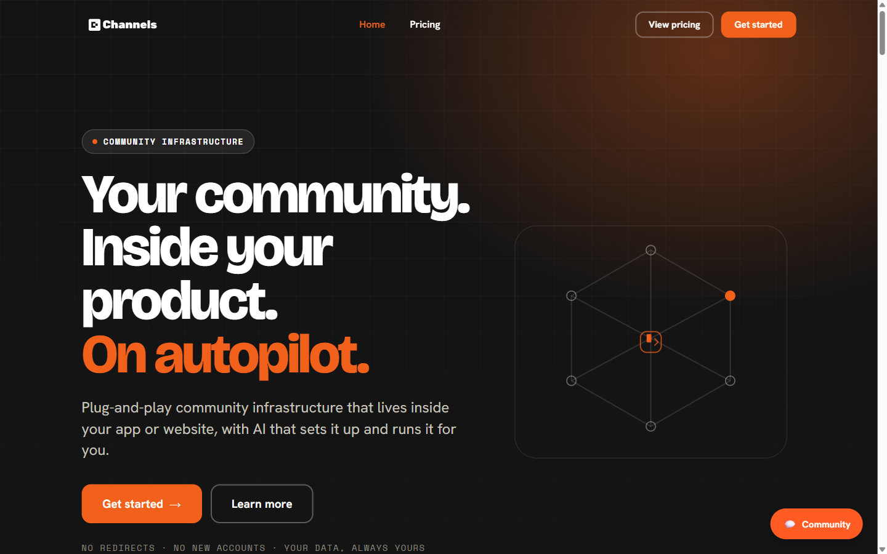
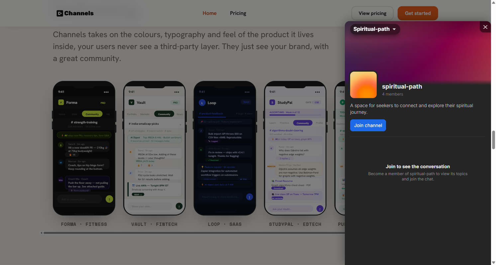
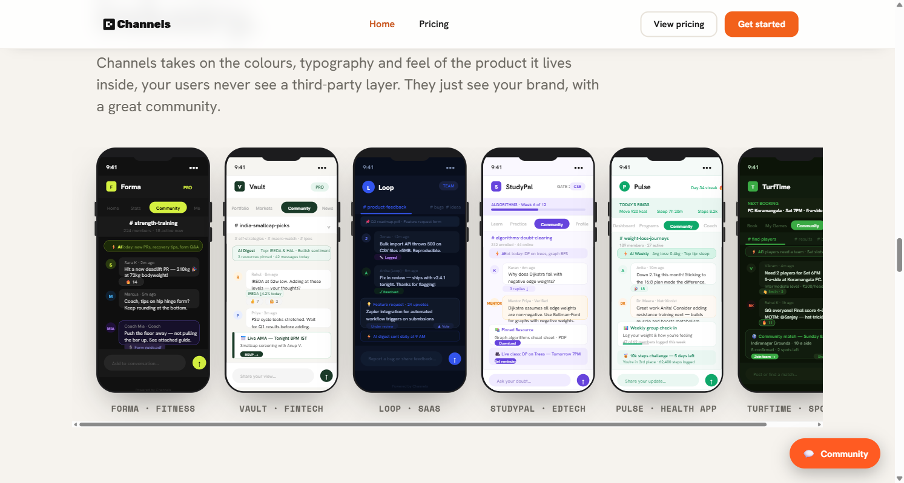
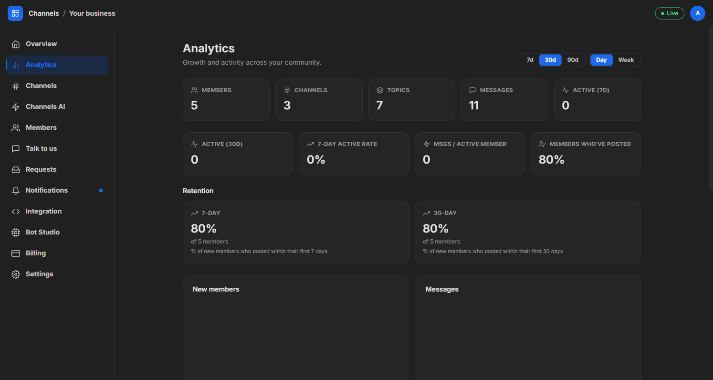
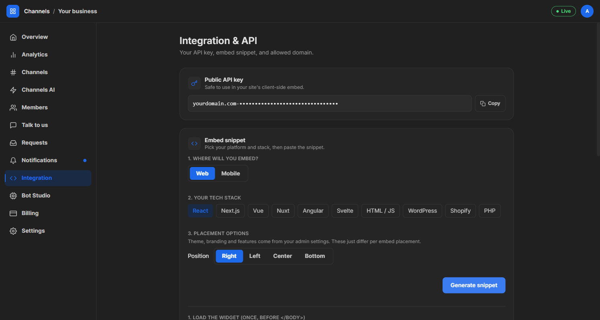
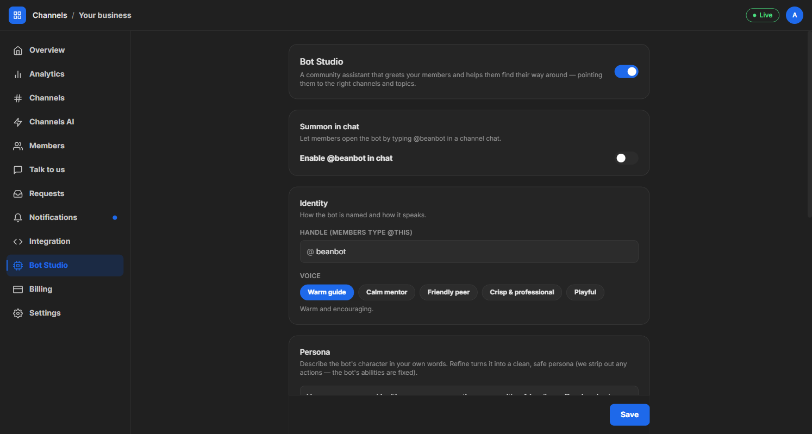
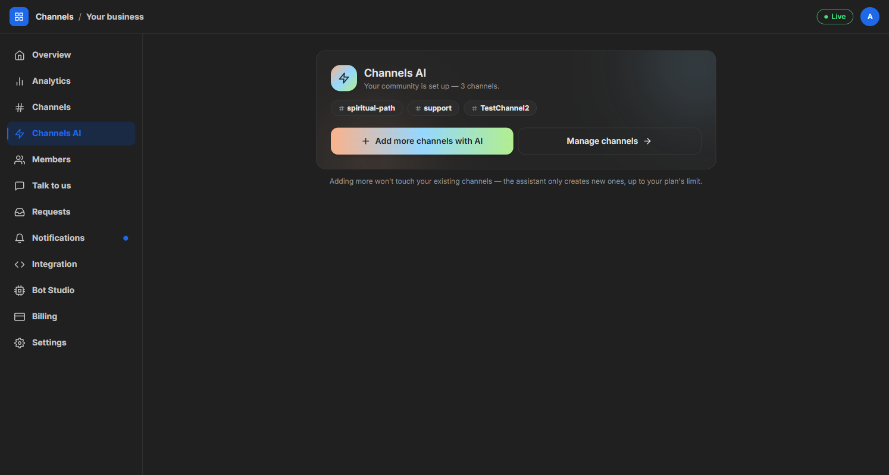
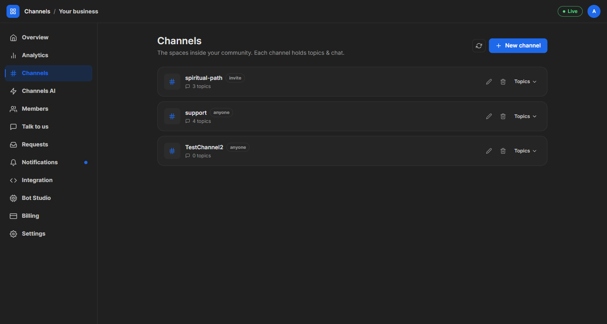
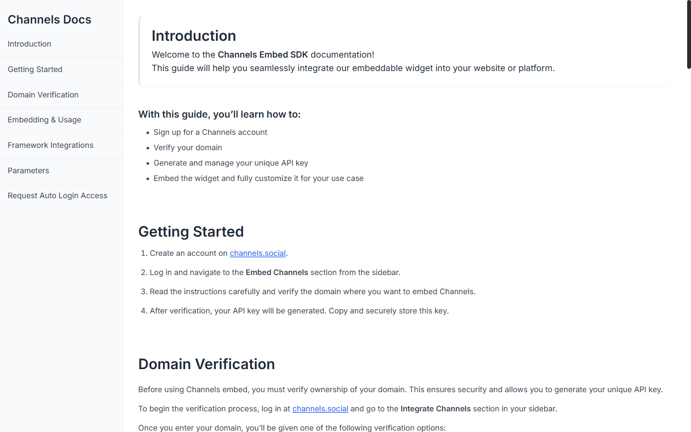
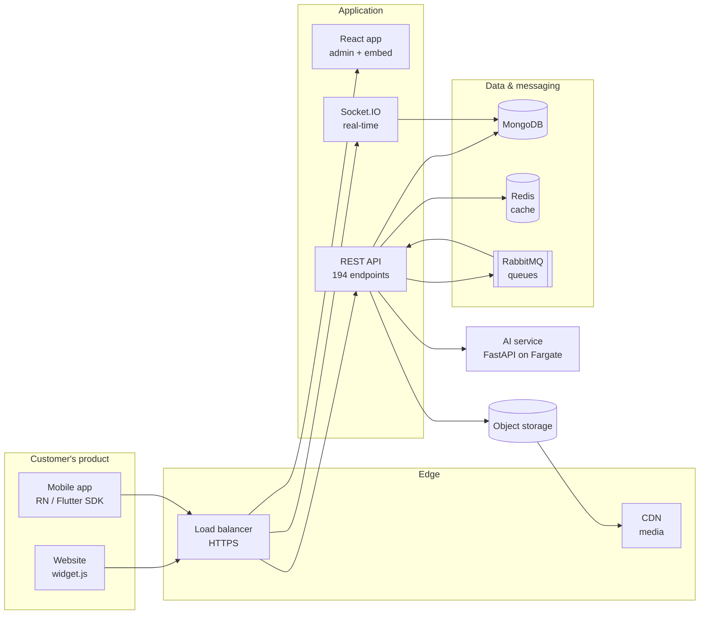

<div align="center">

# Channels

### Your community. Inside your product. On autopilot.

Plug-and-play community infrastructure that lives inside your app or website,
with AI that sets it up and helps run it.

[**Website**](https://channels.social) ·
[**Docs**](https://channels.social/documentation/channels) ·
[**Pricing**](https://channels.social/pricing) ·
[**React Native SDK**](https://www.npmjs.com/package/@channels-social/react-native) ·
[**Flutter SDK**](https://pub.dev/packages/channels_flutter)



</div>

---

## What it is

Channels lets a business add a full community (channels, topics, real-time chat, events, polls, DMs and an AI assistant) to its own website or mobile app with one snippet. Members never leave the product and never create a second account.

- **No redirects.** The community opens inside the customer's site or app.
- **No new accounts.** Members are signed in with the identity the customer already has.
- **Set up by AI.** Paste a website URL; the assistant reads it and proposes a starter community.

```html
<!-- One line on any website -->
<script async src="https://cdn.channels.social/widget.js?apiKey=YOUR_API_KEY"></script>
```

```tsx
// React Native
import { ChannelsCommunity } from "@channels-social/react-native";

<ChannelsCommunity
  apiKey="YOUR_API_KEY"
  user={{ external_id: "u_42", email: "sara@acme.com", name: "Sara" }}
/>
```

```dart
// Flutter
ChannelsCommunity(
  apiKey: 'YOUR_API_KEY',
  user: ChannelsUser(externalId: 'u_42', email: 'sara@acme.com', name: 'Sara'),
)
```

Copy-paste snippets are generated in the dashboard for **14 stacks**: React, Next.js, Vue, Nuxt, Angular, Svelte, plain HTML, WordPress, Shopify, PHP, React Native, Flutter, Android and iOS.

<!-- SCREENSHOTS:START -->

---

## See it

**The widget, live on a website.** Members open the community without leaving the page.



**It takes on the host product's look.** Colours, typography and feel come from the customer's brand.



<table>
<tr>
<td width="50%"><b>Analytics</b><br></td>
<td width="50%"><b>Integration in 14 stacks</b><br></td>
</tr>
<tr>
<td><b>Bot Studio</b><br></td>
<td><b>AI community setup</b><br></td>
</tr>
<tr>
<td><b>Channels and topics</b><br></td>
<td><b>Developer docs</b><br></td>
</tr>
</table>

<!-- SCREENSHOTS:END -->

---

## How it fits together



| | |
|---|---|
| **Frontend** | React 18, Redux Toolkit, Tailwind, Socket.IO client |
| **Backend** | Node.js, Express, Mongoose, Socket.IO, RabbitMQ, Redis |
| **AI** | Python, FastAPI, Amazon Bedrock |
| **Mobile** | React Native and Flutter SDKs |
| **Infra** | AWS (EC2, ECS Fargate, ALB, S3, CloudFront, Route 53), Terraform, Docker, GitHub Actions |

---

## Engineering highlights

### Frontend

- **One codebase, two products.** The same React app runs as the standalone admin product and as the embedded widget. The embed boots its own isolated Redux store that reuses every chat reducer but swaps in embed-specific auth, so embedded sessions never touch the host site's state or the admin session.
- **A loader that can't lose the race.** `widget.js` is a 264-line dependency-free script that reads its API key from its own URL, builds a responsive iframe modal (6 positions), and hands the host's user data to the iframe over `postMessage`, retrying until the iframe acknowledges. No timing assumptions about which side loads first.
- **Brand theming at runtime.** Each customer's accent colours, logo, banner and light/dark/auto theme are applied as CSS variables when the embed loads, with no rebuild.
- **Thirteen feature switches per community.** Events, file sharing, DMs, polls and more can be turned on or off per customer from the dashboard, and the UI reshapes itself.
- **Deep links from native.** A push-notification tap in a mobile app posts a message into the embedded web view, which navigates straight to the right channel and topic.
- **A real admin product.** 12 dashboard sections (analytics, members, requests, billing, Bot Studio, integration and more) and a 5-step setup wizard.

### Backend

- **Multi-tenant from the data model up.** Business → Channel → Topic → Message, with separate membership models and roles at each level. The same email can belong to different communities as different members; a migration replaced global-unique indexes with compound per-tenant ones.
- **Tenant isolation on the socket, not just the API.** The WebSocket handshake verifies a JWT, and every room join is checked against the member's business and topic membership, so one customer's members can never subscribe to another's rooms.
- **Four ways to sign a member in.** Signed JWT from the customer's server (per-business secret), trusted passthrough, Google, or email OTP, selectable per community and enforced against the customer's plan at runtime.
- **Distributed cache invalidation.** Around 43 Redis key families cache plans, counters, member sets and API-key checks. When data changes, a RabbitMQ fanout exchange tells every server instance which keys to drop.
- **Background work on queues.** Email, WhatsApp notifications, newsletters, membership fan-out and website crawling all run on durable RabbitMQ queues, off the request path.
- **Domain ownership verification.** A customer proves they own a domain by DNS TXT record, hosted file or meta tag before an API key is issued.
- **Media pipeline.** Uploads are compressed, videos get generated thumbnails, and everything is served from a CDN.
- **Subscriptions and plan limits.** Recurring billing with signed webhooks, upgrade proration, and plan-level limits (member caps, AI features, auth modes) enforced at runtime.
- **Bulk member import.** CSV or Excel upload with de-duplication and row-level error reporting.
- **Hardened edges.** Content Security Policy, six rate limiters, and SSRF protection on link previews.

### AI

- **Setup assistant.** Give it a website URL. It reads the site and proposes channels and topics that fit the business, which the customer can refine in conversation before anything is created.
- **Community bot with a short leash.** Members summon it by `@name` in chat. It can only take four actions (suggest a channel, open a topic, open events, hand off to the team); the backend re-validates every action and the member confirms before anything happens. It stays on the customer's brand and hands sensitive questions to humans.
- **Structured output, guaranteed.** Every model call is forced through a typed schema, so the backend never parses free text.
- **Bot Studio.** Customers choose the bot's name, voice and behaviour from the dashboard.
- **Topic summaries.** Long discussions are summarised on demand, with token usage recorded per customer.

### DevOps

- **Push to deploy, no stored cloud keys.** GitHub Actions authenticates to AWS with short-lived OIDC credentials, ships the build, and rolls it out with health checks. Test branches deploy to staging; `main` deploys to production.
- **Infrastructure as code.** DNS, certificates, load balancer, servers, storage, CDN, IAM and the container platform are all defined in Terraform.
- **AI service on Fargate.** Private service discovery (no public endpoint), autoscaling from 1 to 3 tasks on CPU, and an IAM policy scoped to the one model it uses.
- **Secrets pulled at deploy time** from a secrets manager, never baked into images.
- **Staging that mirrors production**, with payment test keys so nothing real is ever charged.

---

## Mobile SDKs

| Platform | Package | Install |
|---|---|---|
| React Native | [`@channels-social/react-native`](https://www.npmjs.com/package/@channels-social/react-native) | `npm i @channels-social/react-native react-native-webview` |
| Flutter | [`channels_flutter`](https://pub.dev/packages/channels_flutter) | `flutter pub add channels_flutter` |

Both pass the signed-in user through, accept a channel or topic to open directly, follow the app's theme, and report events back to the host app. Push notifications are an optional add-on for React Native.

---

## By the numbers

| | |
|---|---|
| API endpoints | 194 |
| Data models | 29 |
| Frontend components | 150+ |
| Redux slices | 22 |
| Integration stacks | 14 |
| Commits (backend + frontend) | 460+ |

---

<div align="center">

**Want this in your product?** → [channels.social](https://channels.social)

Questions: [reach@channels.social](mailto:reach@channels.social)

<sub>The source code is private. This page describes what's inside.</sub>

</div>
